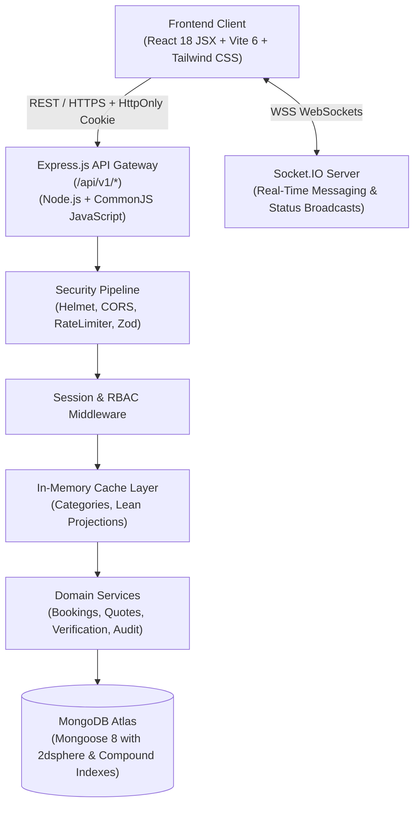

# Lehulu (ለሁሉ) — Ethiopian Local Services Marketplace

> **"Trusted Local Services, For Everyone."**  
> **"ለሁሉ — አስተማማኝ የአካባቢ አገልግሎቶች ለሁሉም"**

Lehulu is a production-grade digital marketplace designed for Ethiopian urban centers—initially serving **Adama** and **Bishoftu**, with architectural readiness for **Addis Ababa** and nationwide scaling. Lehulu connects households and businesses with thoroughly vetted, trustworthy local service professionals across essential trades: plumbing, electrical engineering, carpentry, automotive repair, home & office cleaning, electronics and appliance repair, IT & networking, painting, and tailoring.

[](https://lehulu-two.vercel.app)
[](https://developer.mozilla.org/en-US/docs/Web/JavaScript)
[](#2-core-architecture--technology-stack)
[-success?style=for-the-badge&logo=jest&logoColor=white)](#7-automated-testing--quality-assurance)

---

## Table of Contents
1. [Product Vision & Problem Solved](#1-product-vision--problem-solved)
2. [Core Architecture & Technology Stack](#2-core-architecture--technology-stack)
3. [The 6-Step Booking Lifecycle](#3-the-6-step-booking-lifecycle)
4. [Role Permissions & Capabilities (RBAC)](#4-role-permissions--capabilities-rbac)
5. [Repository Structure](#5-repository-structure)
6. [Getting Started (Local Development)](#6-getting-started-local-development)
7. [Automated Testing & Quality Assurance](#7-automated-testing--quality-assurance)
8. [Production Deployment](#8-production-deployment)
9. [Documentation Index](#9-documentation-index)
10. [License & Acknowledgements](#10-license--acknowledgements)

---

## 1. Product Vision & Problem Solved

In Ethiopia, locating reliable trade professionals has historically depended on informal word-of-mouth, unverified phone contacts, volatile pricing without estimates, and lack of accountability. Customers face:
- **Unverified Credentials**: Inability to identify qualified, background-checked specialists.
- **Opaque Pricing**: Arbitrary, fluctuating fees without written scopes or formal estimates.
- **Safety Concerns**: Unfamiliar individuals entering private homes without administrative oversight.
- **No Recourse**: Absence of milestone tracking, dispute resolution, or verifiable review histories.

For service providers, informal operations constrain growth:
- **Limited Reach**: Customer acquisition confined to immediate neighborhoods.
- **Absence of Reputation**: Lack of digital portfolios, verified status, or customer ratings.
- **Lost Revenue**: Inefficient scheduling, missed requests, and disputed payments.

**Lehulu resolves these challenges through a three-role, trust-first marketplace**:
1. **Customers**: Discover verified providers through focused trade and city search, inspect authentic ratings, submit detailed job requests with private addresses and photo attachments, receive itemized quotations in ETB, chat in real-time, track the 6-step job lifecycle, and rate completed work.
2. **Service Providers**: Pass identity verification, showcase trade credentials and portfolios, receive targeted bookings, send formal itemized quotes, manage job progression through the structured lifecycle, and earn a **"Job Completed • Ready for Another Service"** blue badge.
3. **Administrators**: Audit national IDs and trade licenses, manage the verification queue, approve or revoke provider status with audit trails, curate service categories, resolve customer disputes, and track completed platform transactions.

---

## 2. Core Architecture & Technology Stack

Lehulu is built on an enterprise **100% Pure JavaScript MERN** architecture featuring a native Node.js/Express CommonJS backend, React JSX ESM frontend, layered security, real-time WebSockets, and high-performance caching.



### Technology Matrix

| Layer | Technology | Key Capabilities & Modules |
|---|---|---|
| **Database** | **MongoDB Atlas** | Cloud database with GeoJSON `2dsphere` indexes, compound query indexes, and referential constraints. |
| **ODM** | **Mongoose 8** | 13 native CommonJS models with strict schema validation and `.lean()` query projections. |
| **Backend Runtime** | **Node.js (>=18 LTS)** | High-throughput asynchronous event loop with CommonJS module isolation. |
| **Backend Framework** | **Express.js 4** | RESTful routing (`/api/v1/*`), Helmet security headers, CORS origin allowlists, and structured logging. |
| **Frontend Library** | **React 18** | Pure React JSX architecture with component-driven state and client-side routing. |
| **Build Tool** | **Vite 6** | Lightning-fast HMR, Rollup chunk splitting (`vendor-react`, `vendor-icons`, `vendor-data`), and production minification. |
| **Styling** | **Tailwind CSS 3** | Responsive utility-first design optimized for mobile, tablet, and desktop viewports. |
| **Real-Time Communication** | **Socket.IO** | Room-isolated instant messaging, booking status broadcasts, and notification events. |
| **Authentication** | **Google Identity Services** | Cryptographically verified Google ID tokens, passwordless sessions, and `HttpOnly`, `SameSite` cookies. |
| **Data Validation** | **Zod 3** | End-to-end schema validation for API request bodies, query parameters, and client form inputs. |
| **Bilingual Localization** | **i18n Engine** | Instant toggle between **English** and **Amharic (አማርኛ)** across all views. |
| **Currency Formatting** | **ETB (ብር)** | Itemized labor, materials, and inspection fees formatted in Ethiopian Birr. |

---

## 3. The 6-Step Booking Lifecycle

Lehulu enforces a strictly validated 6-stage finite state machine governing every customer-provider transaction:

```mermaid
stateDiagram-v2
    direction LR
    Step1: 1. REQUESTED
    Step2: 2. QUOTED
    Step3: 3. CONFIRMED
    Step4: 4. IN_PROGRESS
    Step5: 5. COMPLETION_PENDING
    Step6: 6. COMPLETED

    [*] --> Step1: Customer submits booking request
    Step1 --> Step2: Provider submits formal quotation
    Step2 --> Step3: Customer accepts quotation
    Step3 --> Step4: Provider clicks "Start Work"
    Step4 --> Step5: Provider clicks "Mark Completion Pending"
    Step5 --> Step6: Customer confirms job completion
    Step5 --> Step6: Customer submits review (auto-completes)
    Step6 --> [*]: Provider earns "Ready for Another Service" badge
```



1. **Step 1 — REQUESTED**: Customer submits request with problem description, preferred schedule, private service address, and optional reference photos.
2. **Step 2 — QUOTED**: Provider reviews the job requirements and issues an itemized quotation in ETB (labor, parts, inspection fee).
3. **Step 3 — CONFIRMED**: Customer reviews and accepts the quotation. Mutual commitment is locked.
4. **Step 4 — IN_PROGRESS**: Provider arrives on-site and clicks **"Start Work"** (`IN_PROGRESS`). Customer and Admin dashboards reflect active status in real-time.
5. **Step 5 — COMPLETION_PENDING**: Provider completes service tasks and clicks **"Mark Completion Pending"** for customer verification.
6. **Step 6 — COMPLETED**: Customer confirms satisfaction or submits a rating and review, transitioning booking to `COMPLETED`. The provider's completed transactions count increments, platform analytics update, and the provider receives a blue **"Job Completed • Ready for Another Service"** indicator badge.

---

## 4. Role Permissions & Capabilities (RBAC)

| Capability / Resource | CUSTOMER | SERVICE_PROVIDER | ADMIN |
|---|:---:|:---:|:---:|
| Search & Discover Verified Providers (Map & List) | Yes | Yes | Yes |
| Request Service & Receive Itemized Quotes | Yes | No | No |
| Accept / Decline Quotations | Yes | No | No |
| Apply for Provider Onboarding & Submit National ID | No | Yes | No |
| Issue Itemized Quotations in ETB | No | Yes | No |
| Progress Job: Start Work (`IN_PROGRESS`) | No | Yes | No |
| Progress Job: Request Completion (`COMPLETION_PENDING`) | No | Yes | No |
| Final Confirm Completion & Submit Verified Review | Yes | No | Dispute Resolution |
| Audit Verification Queue (Approve / Reject) | No | No | Yes |
| Verified Providers Directory (Inspect & Revoke / Reject) | No | No | Yes |
| Manage Service Categories & Subcategories | No | No | Yes |
| View Platform Analytics & Immutable Audit Logs | No | No | Yes |

---

## 5. Repository Structure

```
lehulu/
├── backend/                       # Express + Node.js + Mongoose JavaScript Backend
│   ├── src/
│   │   ├── config/                # Environment, Atlas DB, Seed scripts (.js)
│   │   ├── controllers/           # Auth, User, Provider, Booking, Quote, Review, Admin (.js)
│   │   ├── middleware/            # Auth, RBAC, Rate-Limit, Validation, Audit Logging (.js)
│   │   ├── models/                # 13 Mongoose models with 2dsphere & compound indexes (.js)
│   │   ├── routes/                # REST API Endpoints (/api/v1/*) (.js)
│   │   ├── sockets/               # Real-time WebSocket handlers & room authorization (.js)
│   │   ├── app.js                 # Express Application setup & middleware pipeline
│   │   └── server.js              # Server bootstrap & WebSocket initialization
│   ├── tests/                     # 71 automated integration & security tests (.js)
│   ├── jest.config.js             # Native Jest configuration for CommonJS
│   └── package.json
├── frontend/                      # React 18 (JSX) + Vite Pure JavaScript Frontend
│   ├── src/
│   │   ├── components/            # Reusable UI, Badges, Modals, Maps, Navbar, Footer (.jsx)
│   │   ├── context/               # AuthContext, LanguageContext, SocketContext (.jsx)
│   │   ├── locales/               # Bilingual dictionaries: en.js & am.js
│   │   ├── pages/                 # 12 React pages (Landing, Discovery, Dashboards, Admin) (.jsx)
│   │   ├── services/              # Pure JavaScript Axios API client (.js)
│   │   ├── test/                  # 12 Vitest frontend component tests (.jsx, .js)
│   │   ├── App.jsx                # Route definitions & lazyRetry chunk resilience
│   │   └── main.jsx               # React Query caching & Google OAuth initialization
│   ├── public/                    # Static assets & favicon
│   ├── vite.config.js             # Chunk splitting & Vitest runner configuration
│   ├── tailwind.config.js         # Custom theme & typography configuration
│   └── package.json
├── docs/                          # Comprehensive Technical Specifications
│   ├── ARCHITECTURE.md            # System architecture, security, state machines
│   ├── DATA_MODELS.md             # Mongoose schemas, indexes, relationships
│   ├── REQUIREMENTS.md            # Functional & non-functional requirements
│   ├── ROLE_PERMISSIONS.md        # RBAC specifications & security boundaries
│   ├── API_DOCUMENTATION.md       # Complete REST API reference
│   └── DEPLOYMENT_GUIDE.md        # Production deployment runbook (Vercel & Render)
├── COMMIT_LOG.md                  # Atomic verification log of all commits
├── render.yaml                    # Infrastructure-as-code blueprint for Render
└── package.json                   # Root workspace manifest with orchestration scripts
```

---

## 6. Getting Started (Local Development)

### Prerequisites
- **Node.js**: `>= 18.x` (v20 or v22 LTS recommended)
- **npm**: `>= 9.x`
- **MongoDB**: Local MongoDB instance or free MongoDB Atlas cluster

### 1. Clone the Repository
```bash
git clone https://github.com/petersisay/lehulu.git
cd lehulu
```

### 2. Configure Environment Variables

**Backend (`backend/.env`)**:
```env
PORT=5000
NODE_ENV=development
CLIENT_URL=http://localhost:5173
MONGODB_URI=mongodb://localhost:27017/lehulu
JWT_SECRET=your_super_secret_jwt_key_at_least_32_characters_long
GOOGLE_CLIENT_ID=your-google-oauth-client-id.apps.googleusercontent.com
ADMIN_EMAIL=admin@lehulu.et
ALLOW_TEST_AUTH=true
```

**Frontend (`frontend/.env`)**:
```env
VITE_API_URL=http://localhost:5000/api/v1
VITE_SOCKET_URL=http://localhost:5000
VITE_GOOGLE_CLIENT_ID=your-google-oauth-client-id.apps.googleusercontent.com
```

### 3. Install Dependencies & Seed Database
```bash
# In backend directory
cd backend
npm install
npm run seed     # Seeds default categories and demo providers for Adama and Bishoftu

# In frontend directory
cd ../frontend
npm install
```

### 4. Run Development Servers
You can run both servers simultaneously from the root directory:
```bash
# From root directory
npm run dev
```

Or run each service individually:
```bash
# Backend (http://localhost:5000)
cd backend && npm run dev

# Frontend (http://localhost:5173)
cd frontend && npm run dev
```

Visit `http://localhost:5173` to explore the Lehulu marketplace.

---

## 7. Automated Testing & Quality Assurance

Lehulu maintains a comprehensive test suite across backend API endpoints, RBAC boundaries, state machine transitions, and frontend components:

```bash
# Run All Tests (Root Orchestration)
npm test

# Run Backend Test Suite (71 Tests)
npm --prefix backend test

# Run Frontend Test Suite (12 Tests)
npm --prefix frontend test

# Run Production Builds
npm run build
```

### Verified Test Results
- **Backend Test Suite**: 4 passed, 4 total (71/71 tests passed, 100%)
- **Frontend Test Suite**: 1 passed, 1 total (12/12 tests passed, 100%)
- **Total Passing Tests**: **83 / 83 tests passing (100%)**
- **Frontend Production Build**: Transformed 1,751 modules in 4.59s with zero errors.

---

## 8. Production Deployment

Lehulu is architected for zero-downtime, continuous deployment:
- **Frontend**: Hosted on [Vercel](https://vercel.com) with global Edge CDN caching and client-side route rewrites.
- **Backend API & WebSockets**: Hosted on [Render](https://render.com) running Node.js 20 LTS with persistent WebSocket connectivity.
- **Database**: [MongoDB Atlas](https://www.mongodb.com/atlas) with automated backups and geospatial indexing.

For full staging and production deployment instructions, see the [Production Deployment Runbook](docs/DEPLOYMENT_GUIDE.md).

---

## 9. Documentation Index

- [Architecture & State Machines](docs/ARCHITECTURE.md)
- [Database Schema & Data Models](docs/DATA_MODELS.md)
- [Role-Based Access Control (RBAC)](docs/ROLE_PERMISSIONS.md)
- [Functional & Non-Functional Requirements](docs/REQUIREMENTS.md)
- [REST API Reference](docs/API_DOCUMENTATION.md)
- [Production Deployment Runbook](docs/DEPLOYMENT_GUIDE.md)

---

## 10. License & Acknowledgements

Developed for the Ethiopian service economy. All rights reserved.  
ለሁሉ — አስተማማኝ የአካባቢ አገልግሎቶች ለሁሉም።
