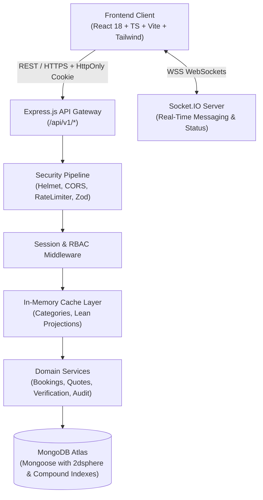

# Lehulu (ለሁሉ) — Ethiopian Local Services Marketplace

> **"Trusted Local Services, For Everyone."**  
> **"ለሁሉ — አስተማማኝ የአካባቢ አገልግሎቶች ለሁሉም"**

Lehulu is a production-grade digital marketplace designed for Ethiopian urban centers—initially serving **Adama** and **Bishoftu**, with architectural readiness for **Addis Ababa** and nationwide scaling. Lehulu connects households and businesses with thoroughly vetted, trustworthy local service professionals across essential trades: plumbing, electrical engineering, carpentry, automotive repair, home & office cleaning, electronics and appliance repair, IT & networking, painting, and tailoring.

[](backend/tests)
[](frontend/src/test)
[](https://www.typescriptlang.org/)
[](https://react.dev/)
[](https://nodejs.org/)
[](https://www.mongodb.com/)
[](#license--contributions)

---

## 1. Product Vision & Problem Solved

In Ethiopia, locating reliable trade professionals has historically depended on informal word-of-mouth, unverified phone contacts, volatile pricing without estimates, and lack of accountability. Customers face:
- **Unverified Credentials**: Inability to identify qualified, background-checked specialists.
- **Opaque Pricing**: Arbitrary, fluctuating fees without written scopes or formal estimates.
- **Safety Concerns**: Unfamiliar individuals entering private homes without administrative oversight.
- **No Recourse**: Absence of milestone tracking, dispute resolution, or verifiable review histories.

For service providers, informal operations constrain growth:
- **Limited Reach**: Customer acquisition confined to immediate neighborhoods.
- **Absence of Reputation**: Lack of digital portfolios, verified status, or customer ratings.
- **Lost Revenue**: Inefficient scheduling, missed requests, and disputed payments.

**Lehulu resolves these challenges through a three-role, trust-first marketplace**:
1. **Customers**: Discover verified providers through focused trade and city search, inspect authentic ratings, submit detailed job requests with private addresses and photo attachments, receive itemized quotations in ETB, chat in real-time, track the 6-step job lifecycle, and rate completed work.
2. **Service Providers**: Pass identity verification, showcase trade credentials and portfolios, receive targeted bookings, send formal itemized quotes, manage job progression through the structured lifecycle, and earn a "Job Completed • Ready for Another Service" blue badge.
3. **Administrators**: Audit national IDs and trade licenses, manage the verification queue, approve or revoke provider status with audit trails, curate service categories, resolve customer disputes, and track completed platform transactions.

---

## 2. Core Architecture & Tech Stack

Lehulu is built on an enterprise MERN stack featuring strict TypeScript typing, layered security, real-time WebSockets, and high-performance caching.



### Technology Highlights
- **Frontend**: React 18, TypeScript, Vite, Tailwind CSS, React Router v6, TanStack Query (React Query), React Hook Form, Zod, Lucide Icons.
- **Backend**: Node.js, Express, TypeScript, Mongoose / MongoDB Atlas, Socket.IO, Helmet, CORS, Rate-Limiter, Zod Validation.
- **Authentication**: Google Identity Services token verification with secure `HttpOnly`, `SameSite` cookies, session management, and role-based onboarding.
- **Performance**: In-memory TTL catalog caching (<1ms response time), $O(1)$ set-based admin verification synchronization, compound database indexing, and code-split frontend bundles (`vendor-react`, `vendor-icons`, `vendor-data`).
- **Localization**: Native bilingual interface supporting **English** and **Amharic (አማርኛ)** with instant language toggling.
- **Currency**: Ethiopian Birr (**ETB / ብር**) with itemized quotation breakdowns.

---

## 3. The 6-Step Booking Lifecycle

Lehulu enforces a strictly validated 6-stage finite state machine governing every customer-provider transaction:

```mermaid
stateDiagram-v2
    direction LR
    Step1: 1. REQUESTED
    Step2: 2. QUOTED
    Step3: 3. CONFIRMED
    Step4: 4. IN_PROGRESS
    Step5: 5. COMPLETION_PENDING
    Step6: 6. COMPLETED

    [*] --> Step1: Customer submits booking request
    Step1 --> Step2: Provider submits formal quotation
    Step2 --> Step3: Customer accepts quotation
    Step3 --> Step4: Provider clicks "Start Work"
    Step4 --> Step5: Provider clicks "Mark Completion Pending"
    Step5 --> Step6: Customer confirms job completion
    Step5 --> Step6: Customer submits 5-star review (auto-completes)
    Step6 --> [*]: Provider earns "Ready for Another Service" badge
```



1. **Step 1 — REQUESTED**: Customer submits request with problem description, preferred schedule, service address, and reference photos.
2. **Step 2 — QUOTED**: Provider reviews the job requirements and issues an itemized quotation in ETB (labor, parts, inspection fee).
3. **Step 3 — CONFIRMED**: Customer reviews and accepts the quotation. Mutual commitment is locked.
4. **Step 4 — IN_PROGRESS**: Provider arrives on-site and clicks **"Start Work"** (`IN_PROGRESS`). Customer and Admin dashboards reflect active status in real-time.
5. **Step 5 — COMPLETION_PENDING**: Provider completes service tasks and clicks **"Mark Completion Pending"** for customer verification.
6. **Step 6 — COMPLETED**: Customer confirms satisfaction or submits a rating and review, transitioning booking to `COMPLETED`. The provider's completed transactions count increments, platform analytics update, and the provider receives a blue **"Job Completed • Ready for Another Service"** indicator badge.

---

## 4. Role Permissions & Capabilities

| Capability / Resource | CUSTOMER | SERVICE_PROVIDER | ADMIN |
|---|:---:|:---:|:---:|
| Search & Discover Verified Providers (Map & List) | Yes | Yes | Yes |
| Request Service & Receive Itemized Quotes | Yes | No | No |
| Accept / Decline Quotations | Yes | No | No |
| Apply for Provider Onboarding & Submit National ID | No | Yes | No |
| Issue Itemized Quotations in ETB | No | Yes | No |
| Progress Job: Start Work (`IN_PROGRESS`) | No | Yes | No |
| Progress Job: Request Completion (`COMPLETION_PENDING`) | No | Yes | No |
| Final Confirm Completion & Submit Verified Review | Yes | No | Dispute Resolution |
| Audit Verification Queue (Approve / Reject) | No | No | Yes |
| Verified Providers Directory (Inspect & Revoke / Reject) | No | No | Yes |
| Manage Service Categories & Subcategories | No | No | Yes |
| View Platform Analytics & Immutable Audit Logs | No | No | Yes |

---

## 5. Repository Structure

```
lehulu/
├── backend/                       # Express + TypeScript + Mongoose Backend
│   ├── src/
│   │   ├── config/                # Environment, Atlas DB, Seed scripts
│   │   ├── controllers/           # Auth, User, Provider, Booking, Quote, Review, Admin
│   │   ├── middleware/            # Auth, RBAC, Rate-Limit, Validation, Audit Logging
│   │   ├── models/                # Schemas with 2dsphere & Compound Indexes
│   │   ├── routes/                # REST API Endpoints (/api/v1/*)
│   │   ├── sockets/               # Real-time WebSocket handlers & room auth
│   │   ├── types/                 # TypeScript interfaces, enums, type definitions
│   │   ├── app.ts                 # Express Application setup & middleware pipeline
│   │   └── server.ts              # Server bootstrap & WebSocket initialization
│   ├── tests/                     # 71 automated integration & security tests
│   └── package.json
├── frontend/                      # React 18 + TypeScript + Vite Frontend
│   ├── src/
│   │   ├── components/            # Reusable UI, Badges, Modals, Maps, Navbar, Footer
│   │   ├── context/               # AuthContext, LanguageContext, SocketContext
│   │   ├── locales/               # Bilingual dictionaries: en.ts & am.ts
│   │   ├── pages/                 # Landing, Discovery, BookingDetail, Dashboards, Admin
│   │   ├── services/              # Typed Axios API client
│   │   ├── types/                 # Shared TypeScript interfaces
│   │   ├── test/                  # 11 Vitest frontend component tests
│   │   ├── App.tsx                # Route definitions & lazyRetry chunk resilience
│   │   └── main.tsx               # React Query caching & Google OAuth initialization
│   ├── public/                    # Static assets & favicon
│   ├── vite.config.ts             # Chunk splitting & test runner configuration
│   └── package.json
├── docs/                          # Comprehensive Technical Specifications
│   ├── ARCHITECTURE.md            # System architecture, security, state machines
│   ├── DATA_MODELS.md             # Mongoose schemas, indexes, relationships
│   ├── REQUIREMENTS.md            # Functional & non-functional requirements
│   ├── ROLE_PERMISSIONS.md        # RBAC specifications & security boundaries
│   ├── API_DOCUMENTATION.md       # Complete REST API reference
│   └── DEPLOYMENT_GUIDE.md        # Production deployment runbook (Vercel & Render)
├── COMMIT_LOG.md                  # Atomic verification log of all commits
└── README.md                      # Project overview & quickstart guide
```

---

## 6. Getting Started (Local Development)

### Prerequisites
- **Node.js**: >= 18.x (v20 or v22 LTS recommended)
- **npm**: >= 9.x
- **MongoDB**: Local MongoDB instance or free MongoDB Atlas cluster

### 1. Clone the Repository
```bash
git clone https://github.com/petersisay/lehulu.git
cd lehulu
```

### 2. Configure Environment Variables

**Backend (`backend/.env`)**:
```env
PORT=5000
NODE_ENV=development
CLIENT_URL=http://localhost:5173
MONGODB_URI=mongodb://localhost:27017/lehulu
JWT_SECRET=your_super_secret_jwt_key_at_least_32_characters_long
GOOGLE_CLIENT_ID=your-google-oauth-client-id.apps.googleusercontent.com
ADMIN_EMAIL=admin@lehulu.et
ALLOW_TEST_AUTH=true
```

**Frontend (`frontend/.env`)**:
```env
VITE_API_URL=http://localhost:5000/api/v1
VITE_SOCKET_URL=http://localhost:5000
VITE_GOOGLE_CLIENT_ID=your-google-oauth-client-id.apps.googleusercontent.com
```

### 3. Install Dependencies & Seed Database
```bash
# In backend directory
cd backend
npm install
npm run seed     # Seeds default categories and demo providers for Adama and Bishoftu

# In frontend directory
cd ../frontend
npm install
```

### 4. Run Development Servers
```bash
# Start Backend (runs on http://localhost:5000)
cd backend
npm run dev

# Start Frontend (runs on http://localhost:5173)
cd ../frontend
npm run dev
```

Visit `http://localhost:5173` to explore the Lehulu marketplace.

---

## 7. Automated Testing & Verification

Lehulu maintains a comprehensive test suite across backend API endpoints, RBAC boundaries, state machine transitions, and frontend components.

```bash
# Run Backend Test Suite (71 Tests)
cd backend
npm test

# Run Frontend Test Suite (11 Tests)
cd frontend
npm test -- --run

# Run TypeScript Typecheck & Production Build
cd backend && npm run build
cd ../frontend && npm run build
```

---

## 8. Documentation Index

- [Architecture & State Machines](docs/ARCHITECTURE.md)
- [Database Schema & Data Models](docs/DATA_MODELS.md)
- [Role-Based Access Control (RBAC)](docs/ROLE_PERMISSIONS.md)
- [Functional & Non-Functional Requirements](docs/REQUIREMENTS.md)
- [REST API Reference](docs/API_DOCUMENTATION.md)
- [Production Deployment Runbook](docs/DEPLOYMENT_GUIDE.md)

---

## 9. License & Contributions

Developed for the Ethiopian service economy. All rights reserved.  
ለሁሉ — አስተማማኝ የአካባቢ አገልግሎቶች ለሁሉም።
