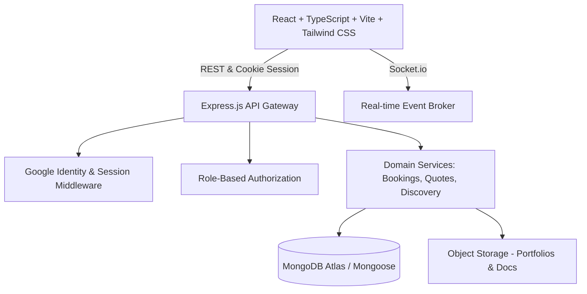

# Lehulu (ለሁሉ) — Ethiopian Local Services Marketplace

> **"Trusted Local Services, For Everyone."**
> **"ለሁሉ — አስተማማኝ የአካባቢ አገልግሎቶች ለሁሉም"**

Lehulu is a production-grade digital marketplace designed for Ethiopian cities—initially focused on **Adama** and **Bishoftu**, with strategic expansion architecture for **Addis Ababa** and nationwide coverage. Lehulu connects households and businesses with verified, trustworthy local service professionals across essential trades: plumbing, electrical, carpentry, automotive repair, home & office cleaning, electronics/appliances, IT & network maintenance, and tailoring.

---

## 1. Product Vision & Problem Solved

In Ethiopia, locating reliable service professionals has historically depended on fragmented word-of-mouth, informal phone calls, uncertain pricing, and unverified credentials. Customers face:
- Difficulty identifying certified or experienced professionals nearby.
- Opaque or fluctuating pricing without formal estimates.
- Safety and trust concerns with unfamiliar workers in private homes.
- Lack of booking tracking, structured dispute resolution, and verifiable reviews.

For service providers, informal operations limit growth:
- Limited reach beyond immediate neighborhoods.
- Lack of digital reputation, verified credentials, and portfolio showcase.
- Inefficient scheduling, missed requests, and inconsistent payment agreements.

**Lehulu resolves this through a three-role, trust-first marketplace**:
1. **Customers** discover nearby providers on interactive maps, compare verifiable reviews, request quotes, schedule bookings, communicate securely, and pay after completion.
2. **Service Providers** undergo administrator identity and qualification verification, showcase portfolios, configure working hours and service areas, send formal quotations, and build real digital reputations.
3. **Administrators** audit provider identity documents, maintain service categories, investigate disputes, and monitor platform health through immutable audit trails.

---

## 2. Core Architecture & Tech Stack

Lehulu is built on modern MERN architecture with strict typing, security headers, and role-based access control.



- **Frontend**: React 18/19, TypeScript, Vite, Tailwind CSS, React Router v6, TanStack Query, React Hook Form, Zod, Lucide Icons, Leaflet / OpenStreetMap.
- **Backend**: Node.js, Express, TypeScript, Mongoose / MongoDB Atlas, Socket.IO, Helmet, CORS, Rate-Limiter, Zod Request Validation.
- **Authentication**: Google Identity Services token verification with secure HttpOnly cookies, session management, and role-based onboarding.
- **Localization**: Full bilingual interface supporting **English** and **Amharic (አማርኛ)**.
- **Currency**: Ethiopian Birr (ETB / ብር).

---

## 3. Strict Three-Role System

| Feature / Permission | CUSTOMER | SERVICE_PROVIDER | ADMIN |
|---|:---:|:---:|:---:|
| Search & Filter Providers (Map & List) | Yes | Yes | Yes |
| Request Service & Receive Quotes | Yes | No | No |
| Accept / Reject Quotations | Yes | No | No |
| Apply for Provider Onboarding | No | Yes | No |
| Configure Service Areas & Rates | No | Yes | No |
| Issue Formal Quotes & Accept Bookings | No | Yes | No |
| Progress Booking to Completion Pending | No | Yes | No |
| Verify Provider Identity & Credentials | No | No | Yes |
| Manage Categories & Moderate Disputes | No | No | Yes |
| View System Health & Audit Logs | No | No | Yes |

---

## 4. Repository Structure

```
lehulu/
├── backend/                  # Express + TypeScript + Mongoose Backend
│   ├── src/
│   │   ├── config/           # Database, environment, storage config
│   │   ├── controllers/      # Auth, profile, provider, booking, admin controllers
│   │   ├── middleware/       # RBAC, auth, rate-limit, validation, audit middleware
│   │   ├── models/           # Mongoose schemas with indexing & constraints
│   │   ├── routes/           # Versioned REST API endpoints (/api/v1/...)
│   │   ├── services/         # Business logic (quotes, bookings, notifications)
│   │   ├── sockets/          # Real-time WebSocket event handlers
│   │   ├── types/            # Shared TypeScript interfaces & enums
│   │   └── server.ts         # Express & Socket.io server bootstrap
│   ├── tests/                # Automated integration & unit tests
│   └── package.json
├── frontend/                 # React + TypeScript + Vite + Tailwind Frontend
│   ├── src/
│   │   ├── assets/           # Logos, icons, branding assets
│   │   ├── components/       # Reusable accessible UI components
│   │   ├── context/          # Auth, Language (EN/AM), Socket contexts
│   │   ├── hooks/            # TanStack Query & custom hooks
│   │   ├── locales/          # English and Amharic translation dictionaries
│   │   ├── pages/            # Landing, Discovery, Bookings, Dashboards
│   │   ├── services/         # Axios typed API client
│   │   └── types/            # Frontend TypeScript types
│   ├── public/
│   └── package.json
├── docs/                     # Architecture, API, Data Models & Security specifications
├── COMMIT_LOG.md             # Atomic commit & push verification record
└── README.md
```

---

## 5. Getting Started (Local Development)

### Prerequisites
- Node.js >= 18.x (v24.x recommended)
- npm >= 9.x
- MongoDB (Local instance or MongoDB Atlas connection string)

### 1. Clone the Repository
```bash
git clone https://github.com/petersisay/lehulu.git
cd lehulu
```

### 2. Configure Environment Variables
Copy `.env.example` templates in both `backend/` and `frontend/`:
```bash
cp backend/.env.example backend/.env
cp frontend/.env.example frontend/.env
```

### 3. Run Backend
```bash
cd backend
npm install
npm run dev
```

### 4. Run Frontend
```bash
cd frontend
npm install
npm run dev
```

Visit `http://localhost:5173` to explore the Lehulu marketplace.

---

## 6. License & Contributions

Developed for the Ethiopian service economy. All rights reserved.
