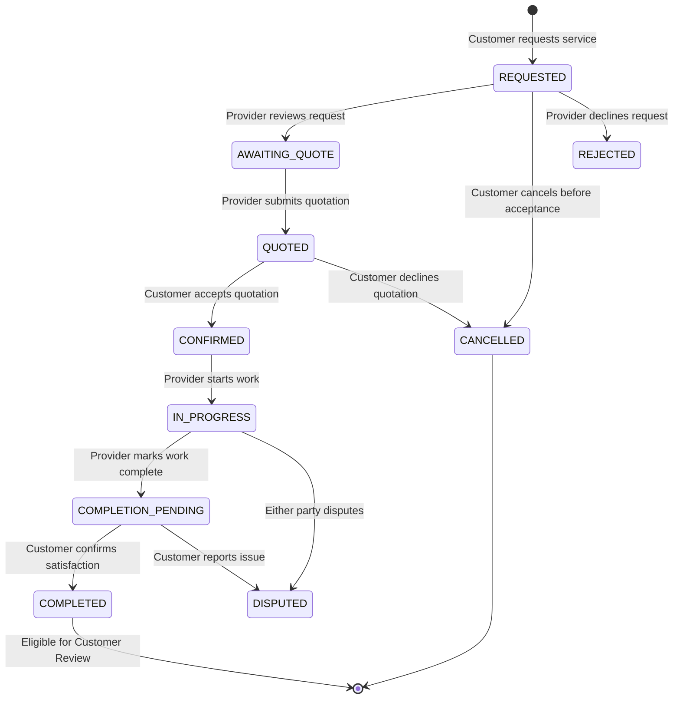

# Lehulu (ለሁሉ) — System Architecture Document

## 1. Architectural Overview
Lehulu is built following clean, layered architectural principles:
- **Presentation Layer**: React Single Page Application (SPA) with TypeScript, Vite, Tailwind CSS, Lucide icons, and React Router. State is managed via TanStack Query (server state), React Hook Form (client forms), and React Context (Auth, Language, Socket).
- **API & Gateway Layer**: Express.js REST API with versioned endpoints (`/api/v1/*`), Helmet security headers, CORS origin enforcement, rate limiting, and structured logging.
- **Real-Time Communication Layer**: Socket.IO server coordinated with session authorization for instant booking updates and direct messaging between matched parties.
- **Domain & Service Layer**: Business logic modules decoupling request handling from data persistence:
  - `AuthService`: Google OAuth ID token verification, session lifecycle, role onboarding.
  - `ProviderService`: Search, geolocation filtering, rating calculation, profile management.
  - `BookingService`: Finite state machine for request, quotation, confirmation, completion.
  - `VerificationService`: Administrator auditing workflows and credential management.
  - `MessagingService`: Authorized room communication and notifications.
- **Data Persistence Layer**: MongoDB Atlas accessed via Mongoose ORM with schema validation, compound indexes, and referential constraints.

```mermaid
flowchart TD
    subgraph Client["Frontend Client (Vite + React + TS)"]
        UI[UI Components & Tailwind]
        Router[React Router v6]
        Query[TanStack Query Cache]
        Leaflet[Leaflet Map Discovery]
        I18n[Bilingual i18n Engine (EN / AM)]
    end

    subgraph Gateway["Express API & Security Gateway"]
        Helmet[Helmet Security Headers]
        CORS[CORS Allowlist]
        RateLimit[Rate Limiter Middleware]
        AuthMW[Session / RBAC Middleware]
        ZodMW[Zod Request Validation]
    end

    subgraph RealTime["Real-Time Gateway"]
        SocketServer[Socket.IO Server]
        RoomAuth[Room Participant Verification]
    end

    subgraph Services["Domain Services"]
        AuthSvc[Auth & Profile Service]
        CatSvc[Category Service]
        ProvSvc[Provider & Search Service]
        BookSvc[Booking State Machine]
        QuoteSvc[Quotation Engine]
        MsgSvc[Messaging & Notification Service]
        AdminSvc[Verification & Audit Service]
    end

    subgraph Data["Database & Storage"]
        Mongo[(MongoDB Atlas / Mongoose Models)]
        Storage[(Persistent Object Storage)]
    end

    Client -->|HTTPS / Secure Cookies| Gateway
    Client <-->|WSS WebSockets| RealTime
    Gateway --> Helmet --> CORS --> RateLimit --> AuthMW --> ZodMW --> Services
    RealTime --> RoomAuth --> MsgSvc
    Services --> Mongo
    Services --> Storage
```

## 2. Security Architecture

### 2.1 Google-First Authentication & Identity Validation
- Customer and provider accounts authenticate with Google Identity Services.
- The client receives a Google ID token (JWT) from Google's credential response.
- The backend verifies the token using Google's official public keys, verifying:
  - Token signature and algorithm (`RS256`).
  - Audience matches the configured Google Client ID.
  - Issuer is `accounts.google.com` or `https://accounts.google.com`.
  - Expiration timestamp.
  - Email verification flag.
- The backend matches or provisions a unique `User` record mapped to Google's stable subject ID (`googleId`), generates a cryptographically random session token or signed JWT, and stores it in an `HttpOnly`, `SameSite=Strict`, `Secure` (in production) cookie.
- A CSRF protection mechanism validates requests modifying state.

### 2.2 Three-Role Authorization (RBAC)
- Role assignment is governed by explicit server-side logic:
  - `CUSTOMER`: Default for search, booking, reviewing.
  - `SERVICE_PROVIDER`: Assigned upon provider onboarding; verification badge (`isVerified`) is strictly controlled by administrators.
  - `ADMIN`: Assigned solely via server configuration (`ADMIN_EMAIL` match or database seed); users cannot self-escalate.
- Middleware:
  - `requireAuth`: Confirms active session and attaches `req.user`.
  - `requireRole(...roles)`: Verifies role membership.
  - `requireVerifiedProvider`: Enforces that only approved providers can accept jobs.

### 2.3 Location Privacy Protection
- Precise customer residential addresses are stored in private booking records only accessible to the customer and the accepted provider.
- Providers define service coverage zones (e.g., "Adama - Kebele 02 to 09", "Bishoftu - Central & Babogaya") and optional public commercial workshop locations.
- Public search displays approximate distances or service areas, never private residences.

## 3. Data Integrity & State Machines

### 3.1 Booking Lifecycle State Machine


## 4. Scalability & Extensibility
- **Geographic Extensibility**: Geolocation queries leverage MongoDB 2dsphere indexing with hierarchical boundary fallbacks (`city`, `subcity`, `kebele`).
- **Payment Modularity**: Decoupled transaction interface (`PaymentTransaction`) supporting Cash/Pay-After-Service initially with modular hooks for Chapa and Telebirr.
- **Internationalization**: Client localization dictionary with standard JSON keys for English (`en`) and Amharic (`am`).
