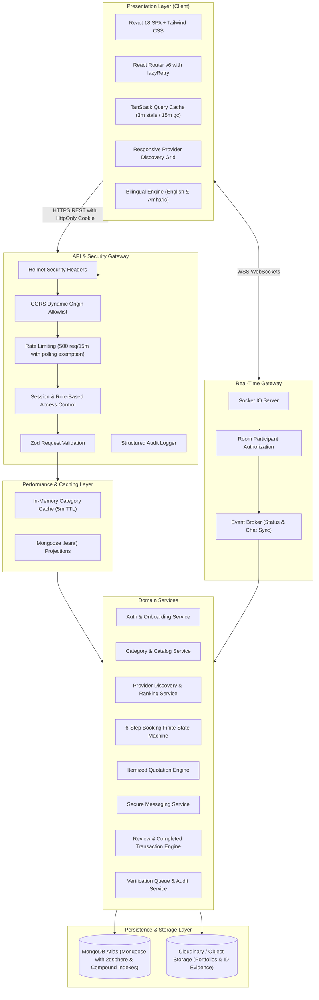
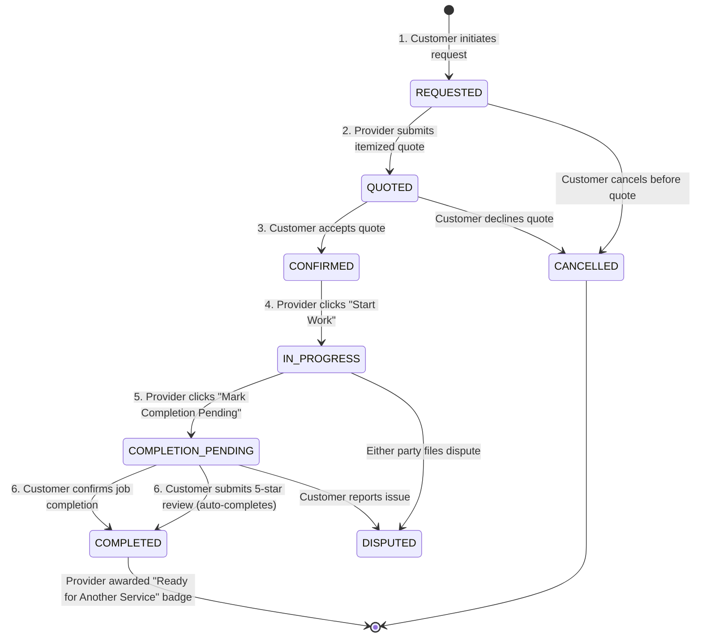
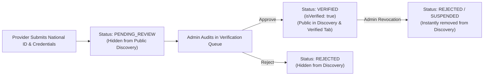

# Lehulu (ለሁሉ) — System Architecture Document

## 1. Architectural Overview

Lehulu is built following clean, layered architectural principles designed for performance, resilience, and strict domain boundaries:

### Layer Responsibilities
- **Presentation Layer**: React Single Page Application (SPA) with TypeScript, Vite, and Tailwind CSS. State is orchestrated via TanStack Query (server state), React Hook Form with Zod schemas (client forms), and React Context (`AuthContext`, `LanguageContext`, `SocketContext`).
- **Gateway & Security Layer**: Express.js REST API with versioned endpoints (`/api/v1/*`), Helmet security headers, CORS origin enforcement, rate limiting, and structured logging.
- **Real-Time Communication Layer**: Socket.IO server coordinated with session authorization for instant booking updates, room-isolated chat messages, and notification broadcasts.
- **Performance & Caching Layer**: In-memory TTL caching with atomic write-invalidation for catalog data, alongside optimized compound indexing and `.lean()` database queries.
- **Data Persistence Layer**: MongoDB Atlas accessed via Mongoose ORM with schema validation, geospatial 2dsphere indexing, and referential constraints.

---

## 2. Security Architecture

### 2.1 Google-First Authentication & Identity Validation
- Customer and provider accounts authenticate with Google Identity Services.
- The client receives a Google ID token (JWT) from Google's credential response.
- The backend verifies the token using Google's official public keys, checking:
  - Token signature and algorithm (`RS256`).
  - Audience matches the configured Google Client ID.
  - Issuer is `accounts.google.com` or `https://accounts.google.com`.
  - Expiration timestamp.
  - Email verification flag.
- The backend matches or provisions a unique `User` record mapped to Google's stable subject ID (`googleId`), generates a cryptographically random session token or signed JWT, and stores it in an `HttpOnly`, `SameSite=Lax/Strict`, `Secure` (in production) cookie.
- CSRF protection and origin verification validate requests modifying state.

### 2.2 Three-Role Authorization (RBAC)
Role assignment is strictly governed by server-side logic:
- `CUSTOMER`: Default role for discovering providers, booking appointments, reviewing completed services.
- `SERVICE_PROVIDER`: Assigned upon provider onboarding; verification badge (`isVerified`) is strictly controlled by administrators.
- `ADMIN`: Assigned solely via server configuration (`ADMIN_EMAIL` match or database seed); users cannot self-escalate.

### 2.3 Location Privacy Protection
- Precise customer residential addresses are stored in private booking records only accessible to the customer and the accepted provider.
- Providers define service coverage zones (e.g., "Adama - Kebele 02 to 09", "Bishoftu - Central & Babogaya") and optional public commercial workshop locations.
- Public search displays approximate distances or service areas, never private residences.

---

## 3. The 6-Step Booking Lifecycle State Machine

Lehulu implements a robust finite state machine for service fulfillment:

### State Machine Rules
1. **Transition Guard**: Only the assigned provider can transition `CONFIRMED -> IN_PROGRESS` and `IN_PROGRESS -> COMPLETION_PENDING`.
2. **Dual-Confirmation or Review Auto-Transition**: Step 6 (`COMPLETED`) requires customer satisfaction confirmation or submission of a rating and review on `/api/v1/reviews/:bookingId`, which automatically advances the booking to `COMPLETED` if currently in `COMPLETION_PENDING`.
3. **Transaction Metrics**: When reaching `COMPLETED`, the provider's `completedBookingsCount` atomically increments, the admin dashboard's platform completed transactions counter increments, and the provider receives the blue indicator badge.

---

## 4. Provider Status & Verification Workflow

### Verification Pipeline Features:
- **Pending Review Queue**: Providers awaiting verification are listed in the Admin dashboard with side-by-side credential inspection, masked national ID display, and document links.
- **Verified Providers Tab**: Approved specialists appear in a dedicated administrative directory allowing admins to inspect their live customer profile (`/providers/:id`) or immediately revoke/reject verification with audit logging.
- **Self-Healing Synchronization**: High-performance bulk set synchronization guarantees consistency between `ProviderProfile` and `ProviderVerification` records without $O(N)$ sequential queries.

---

## 5. Performance & Scalability Architecture

### 5.1 In-Memory Caching (<1ms Response)
- The service category catalog (`GET /api/v1/categories`) is stored in an in-memory cache with a 5-minute TTL and `.lean()` projection.
- Cache invalidation occurs automatically and instantly upon any administrative category mutation (`createCategory`, `updateCategory`, `deleteCategory`).
- Responses include the `X-Cache: HIT` or `X-Cache: MISS` header for transparent observability.

### 5.2 Database Compound Indexing
To support low-latency queries as data scales, the following composite indexes are enforced:
- `ProviderProfile`:
  - `{ location: '2dsphere' }` (Geospatial proximity queries)
  - `{ categoryIds: 1, isVerified: 1, isAvailable: 1 }` (Category browsing)
  - `{ isVerified: 1, verificationStatus: 1, isAvailable: 1 }` (Customer directory)
  - `{ serviceCities: 1, isVerified: 1, rating: -1 }` (City-based search)
- `Booking`:
  - `{ customerId: 1, status: 1 }` (Customer dashboard active bookings)
  - `{ providerId: 1, status: 1 }` (Provider dashboard active bookings)
  - `{ createdAt: -1 }` (Chronological ordering)
- `ProviderVerification`:
  - `{ status: 1, submittedAt: -1 }` (Admin queue sorting)
- `Review`:
  - `{ bookingId: 1 }` (Unique constraint: exactly one review per booking)
  - `{ providerId: 1, rating: -1 }` (Top-rated provider reviews)
  - `{ providerId: 1, createdAt: -1 }` (Chronological review feed)
- `AuditLog`:
  - `{ timestamp: -1 }` (Audit trail log ordering)

### 5.3 Frontend Resilience & Chunk Splitting
- **Code Splitting**: Rollup `manualChunks` divides application code into `vendor-react`, `vendor-maps`, `vendor-icons`, `vendor-data`, and lazy-loaded page modules.
- **Dynamic Chunk Recovery**: `lazyRetry` wrapper around `React.lazy` combined with the window `vite:preloadError` listener automatically reloads outdated client tabs after new production deployments, eliminating blank screen chunk-load errors.
- **Optimized Server-State Caching**: TanStack Query is configured with `staleTime: 3min`, `gcTime: 15min`, and `refetchOnReconnect: true`, minimizing redundant network roundtrips while preserving instantaneous navigation.
