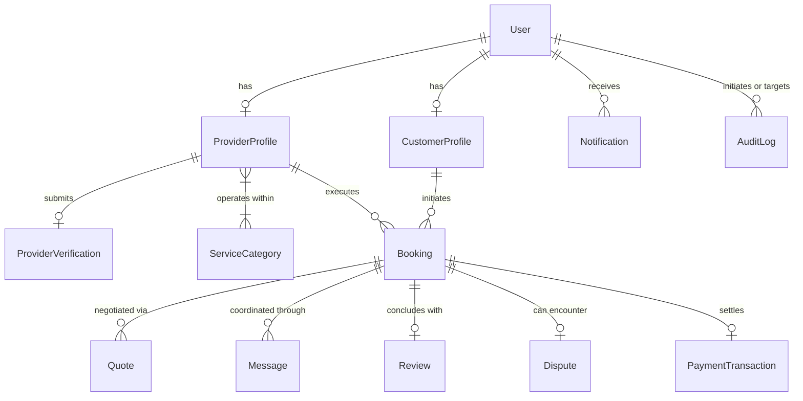

# Lehulu (ለሁሉ) — Database Schema & Data Models Specification

## 1. Schema Design Principles

- **MongoDB Atlas with Mongoose ORM**: Strict typing, schema validation, compound indexes, and referential constraints.
- **Geospatial Proximity Queries**: GeoJSON `2dsphere` indexes on coordinates (`[longitude, latitude]`) enabling sub-10ms proximity searches across Adama, Bishoftu, and Addis Ababa.
- **High-Performance Compound Indexing**: Pre-indexed query paths for category filtering, verification status checks, booking status tracking, and chronological feeds.
- **Privacy by Design**: Sensitive customer residential addresses and national ID verification documents are isolated from public projection queries.
- **Auditability & Traceability**: Dedicated immutable `AuditLog` records for all administrative interventions.

---

## 2. Entity Relationship Overview



---

## 3. Detailed Data Models

### 3.1 User Model (`users`)
Central identity store linked to Google authentication.
```typescript
interface IUser extends Document {
  googleId: string; // Indexed, unique
  email: string; // Indexed, unique, lowercase, trimmed
  displayName: string;
  avatarUrl?: string;
  phoneNumber?: string;
  role: 'CUSTOMER' | 'SERVICE_PROVIDER' | 'ADMIN';
  preferredLanguage: 'en' | 'am';
  city: string; // 'Adama', 'Bishoftu', 'Addis Ababa', etc.
  isActive: boolean;
  isOnboarded: boolean;
  isVerified?: boolean;
  lastLoginAt: Date;
  createdAt: Date;
  updatedAt: Date;
}
```
**Indexes**:
- `{ googleId: 1 }` (unique)
- `{ email: 1 }` (unique)
- `{ role: 1 }`

---

### 3.2 ProviderProfile Model (`providerprofiles`)
Detailed trade and business profile for service providers.
```typescript
interface IProviderProfile extends Document {
  userId: Types.ObjectId; // Ref: 'User', unique
  businessName: string;
  bioEn: string;
  bioAm?: string;
  experienceYears: number;
  categoryIds: Types.ObjectId[]; // Ref: 'ServiceCategory'
  skills: string[];
  serviceCities: string[]; // e.g. ['Adama', 'Bishoftu']
  serviceRadiusKm: number; // default: 15
  location: {
    type: 'Point';
    coordinates: [number, number]; // [lng, lat]
  };
  publicAddress?: string; // Workshop or commercial address, NOT private home
  pricing: {
    model: 'HOURLY' | 'FIXED' | 'INSPECTION' | 'CUSTOM';
    startingPrice: number; // in ETB
    hourlyRate?: number;
    inspectionFee?: number;
  };
  workingHours: {
    dayOfWeek: number; // 0 (Sun) - 6 (Sat)
    open: string; // "08:00"
    close: string; // "18:00"
    isClosed: boolean;
  }[];
  portfolioImages: string[];
  isVerified: boolean; // default: false (Admin controlled)
  verificationStatus: 'PENDING_REVIEW' | 'VERIFIED' | 'REJECTED' | 'NEEDS_RECHECK' | 'SUSPENDED';
  rating: number; // 0.0 - 5.0, computed from verified reviews
  reviewCount: number; // Count of reviews
  completedBookingsCount: number; // Incremented on each Step 6 completion
  isAvailable: boolean;
  createdAt: Date;
  updatedAt: Date;
}
```
**Compound Indexes**:
- `{ location: '2dsphere' }` (Geospatial queries)
- `{ categoryIds: 1, isVerified: 1, isAvailable: 1 }` (Trade category filtering)
- `{ isVerified: 1, verificationStatus: 1, isAvailable: 1 }` (Customer directory)
- `{ serviceCities: 1, isVerified: 1, rating: -1 }` (City ranking)

---

### 3.3 ProviderVerification Model (`providerverifications`)
Administrative credential verification evidence submitted during onboarding.
```typescript
interface IProviderVerification extends Document {
  providerProfileId: Types.ObjectId; // Ref: 'ProviderProfile', unique
  userId: Types.ObjectId; // Ref: 'User'
  nationalIdNumber: string; // Masked on client (e.g., ET-***-4821)
  idCardImageUrl?: string;
  consentGiven?: boolean;
  tradeLicenseUrl?: string;
  certificateUrls: string[];
  status: 'PENDING_REVIEW' | 'VERIFIED' | 'REJECTED' | 'NEEDS_RECHECK' | 'SUSPENDED';
  reviewedBy?: Types.ObjectId; // Ref: 'User' (Admin)
  rejectionReason?: string;
  adminNotes?: string;
  submittedAt: Date;
  reviewedAt?: Date;
  createdAt: Date;
  updatedAt: Date;
}
```
**Indexes**:
- `{ providerProfileId: 1 }` (unique)
- `{ userId: 1 }`
- `{ status: 1, submittedAt: -1 }` (Admin verification queue sorting)

---

### 3.4 ServiceCategory Model (`servicecategories`)
Hierarchical trade service catalog.
```typescript
interface ISubcategory {
  nameEn: string;
  nameAm: string;
  slug: string;
}

interface IServiceCategory extends Document {
  nameEn: string;
  nameAm: string;
  slug: string; // unique, lowercase (e.g., 'plumbing')
  descriptionEn: string;
  descriptionAm: string;
  icon: string; // Lucide icon identifier (e.g., 'Wrench', 'Zap')
  displayOrder: number;
  isActive: boolean;
  subcategories: ISubcategory[];
  createdAt: Date;
  updatedAt: Date;
}
```
**Indexes**:
- `{ slug: 1 }` (unique)
- `{ isActive: 1, displayOrder: 1 }` (Cached catalog query optimization)

---

### 3.5 Booking Model (`bookings`)
Core finite state machine tracking transactions through the 6-stage lifecycle.
```typescript
interface IBookingAddress {
  city: string; // 'Adama', 'Bishoftu', etc.
  subcityOrKebele: string; // e.g., 'Kebele 03'
  specificLocation: string; // Private street address or landmark
  coordinates?: {
    latitude: number;
    longitude: number;
  };
}

interface IBooking extends Document {
  bookingNumber: string; // Unique human-readable ID (e.g., 'BK-2026-9814')
  customerId: Types.ObjectId; // Ref: 'User'
  providerId: Types.ObjectId; // Ref: 'ProviderProfile'
  categoryId: Types.ObjectId; // Ref: 'ServiceCategory'
  status:
    | 'REQUESTED'
    | 'AWAITING_QUOTE'
    | 'QUOTED'
    | 'CONFIRMED'
    | 'IN_PROGRESS'
    | 'COMPLETION_PENDING'
    | 'COMPLETED'
    | 'CANCELLED'
    | 'DISPUTED';
  requestedDate: Date;
  requestedTimeSlot: string; // e.g., '09:00 - 12:00'
  problemDescription: string;
  referenceImages: string[];
  serviceAddress: IBookingAddress; // Protected private address
  agreedPrice?: {
    amount: number; // in ETB
    breakdown?: string;
  };
  cancellationReason?: string;
  cancelledBy?: Types.ObjectId; // Ref: 'User'
  completionRequestedAt?: Date;
  completedAt?: Date;
  createdAt: Date;
  updatedAt: Date;
}
```
**Compound Indexes**:
- `{ customerId: 1, status: 1 }` (Customer dashboard active bookings)
- `{ providerId: 1, status: 1 }` (Provider dashboard active bookings)
- `{ createdAt: -1 }` (Chronological ordering)

---

### 3.6 Quote Model (`quotes`)
Itemized formal price quotation submitted by providers before job confirmation.
```typescript
interface IQuoteItem {
  description: string;
  quantity: number;
  unitPrice: number; // ETB
  total: number; // ETB
}

interface IQuote extends Document {
  bookingId: Types.ObjectId; // Ref: 'Booking'
  providerId: Types.ObjectId; // Ref: 'ProviderProfile'
  customerId: Types.ObjectId; // Ref: 'User'
  items: IQuoteItem[];
  laborCost: number; // ETB
  materialCost: number; // ETB
  inspectionFee?: number; // ETB
  totalAmount: number; // ETB
  notes?: string;
  estimatedDurationHours?: number;
  status: 'PENDING' | 'ACCEPTED' | 'REJECTED' | 'EXPIRED';
  validUntil: Date;
  createdAt: Date;
  updatedAt: Date;
}
```
**Indexes**:
- `{ bookingId: 1 }`
- `{ providerId: 1 }`
- `{ customerId: 1 }`

---

### 3.7 Review Model (`reviews`)
Authentic customer feedback tied strictly to completed bookings.
```typescript
interface IReview extends Document {
  bookingId: Types.ObjectId; // Ref: 'Booking', unique (1 review per booking)
  customerId: Types.ObjectId; // Ref: 'User'
  providerId: Types.ObjectId; // Ref: 'ProviderProfile'
  rating: number; // 1 to 5 integer
  comment: string;
  providerResponse?: {
    text: string;
    respondedAt: Date;
  };
  isReported: boolean;
  createdAt: Date;
  updatedAt: Date;
}
```
**Compound Indexes**:
- `{ bookingId: 1 }` (unique constraint)
- `{ providerId: 1, rating: -1 }` (Top ratings sort)
- `{ providerId: 1, createdAt: -1 }` (Chronological reviews feed)

---

### 3.8 AuditLog Model (`auditlogs`)
Immutable append-only administrative ledger.
```typescript
interface IAuditLog extends Document {
  actorId: Types.ObjectId; // Ref: 'User' (Admin)
  actorEmail: string;
  action: string; // e.g. 'PROVIDER_VERIFIED', 'PROVIDER_REJECTED', 'CATEGORY_CREATED'
  entityType: string; // 'ProviderProfile', 'ProviderVerification', 'ServiceCategory'
  entityId: Types.ObjectId;
  details: Record<string, any>;
  ipAddress?: string;
  userAgent?: string;
  timestamp: Date;
}
```
**Indexes**:
- `{ timestamp: -1 }`
- `{ actorId: 1 }`
- `{ action: 1 }`
- `{ entityId: 1 }`

---

### 3.9 Message Model (`messages`)
Room-isolated in-app communications between booking participants.
```typescript
interface IMessage extends Document {
  bookingId: Types.ObjectId; // Ref: 'Booking'
  senderId: Types.ObjectId; // Ref: 'User'
  receiverId: Types.ObjectId; // Ref: 'User'
  content: string;
  readAt?: Date;
  attachments?: string[];
  createdAt: Date;
  updatedAt: Date;
}
```
**Indexes**:
- `{ bookingId: 1, createdAt: 1 }`

---

### 3.10 Dispute Model (`disputes`)
Formal conflict escalation mechanism for unresolvable service issues.
```typescript
interface IDispute extends Document {
  bookingId: Types.ObjectId; // Ref: 'Booking'
  initiatorId: Types.ObjectId; // Ref: 'User'
  respondentId: Types.ObjectId; // Ref: 'User'
  reason: string;
  description: string;
  evidenceUrls: string[];
  status: 'OPEN' | 'UNDER_REVIEW' | 'RESOLVED' | 'CLOSED';
  resolutionNotes?: string;
  resolvedBy?: Types.ObjectId; // Ref: 'User' (Admin)
  resolvedAt?: Date;
  createdAt: Date;
  updatedAt: Date;
}
```
