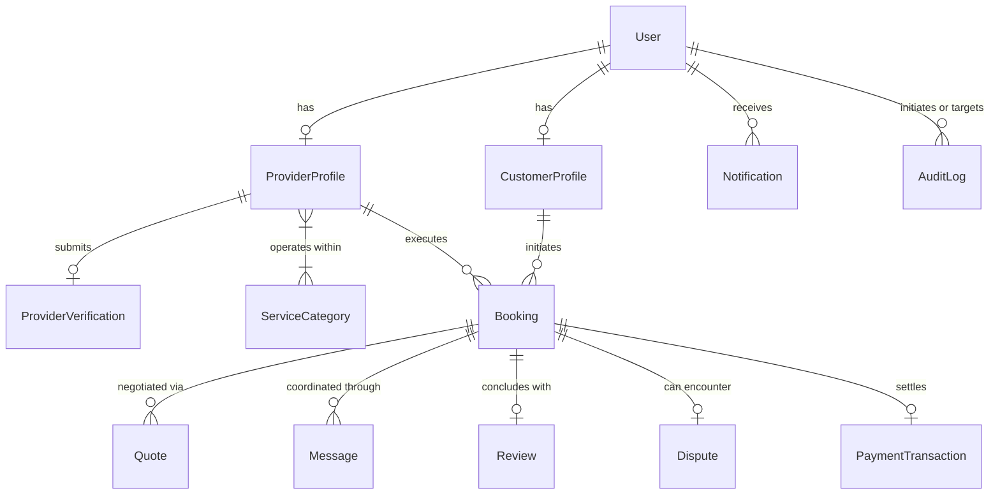

# Lehulu (ለሁሉ) — Database Schema & Data Models Specification

## 1. Schema Design Principles

- **MongoDB Atlas with Mongoose 8 ORM**: Native JavaScript CommonJS schemas, strict typing, schema validation, compound indexes, and referential constraints.
- **Geospatial Proximity Queries**: GeoJSON `2dsphere` indexes on coordinates (`[longitude, latitude]`) enabling sub-10ms proximity searches across Adama, Bishoftu, and Addis Ababa.
- **High-Performance Compound Indexing**: Pre-indexed query paths for category filtering, verification status checks, booking status tracking, and chronological feeds.
- **Privacy by Design**: Sensitive customer residential addresses and national ID verification documents are isolated from public projection queries.
- **Auditability & Traceability**: Dedicated immutable `AuditLog` records for all administrative interventions.

---

## 2. Entity Relationship Overview



---

## 3. Detailed Data Models (Native Mongoose Schemas)

### 3.1 User Model (`users`)
Central identity store linked to Google authentication. Defined in `backend/src/models/User.js`.

```javascript
const mongoose = require('mongoose');

const UserSchema = new mongoose.Schema({
  googleId: { type: String, required: true, unique: true, index: true },
  email: { type: String, required: true, unique: true, lowercase: true, trim: true, index: true },
  displayName: { type: String, required: true, trim: true },
  avatarUrl: { type: String },
  phoneNumber: { type: String, trim: true },
  role: { 
    type: String, 
    enum: ['CUSTOMER', 'SERVICE_PROVIDER', 'ADMIN'], 
    default: 'CUSTOMER',
    index: true 
  },
  preferredLanguage: { type: String, enum: ['en', 'am'], default: 'am' },
  city: { type: String, required: true, default: 'Adama' },
  isActive: { type: Boolean, default: true },
  isOnboarded: { type: Boolean, default: false },
  isVerified: { type: Boolean, default: false },
  lastLoginAt: { type: Date, default: Date.now }
}, {
  timestamps: true
});

module.exports = mongoose.model('User', UserSchema);
```

**Indexes**:
- `{ googleId: 1 }` (unique)
- `{ email: 1 }` (unique)
- `{ role: 1 }`

---

### 3.2 ProviderProfile Model (`providerprofiles`)
Detailed trade and business profile for service providers. Defined in `backend/src/models/ProviderProfile.js`.

```javascript
const mongoose = require('mongoose');

const WorkingHourSchema = new mongoose.Schema({
  dayOfWeek: { type: Number, min: 0, max: 6, required: true },
  open: { type: String, default: '08:00' },
  close: { type: String, default: '18:00' },
  isClosed: { type: Boolean, default: false }
}, { _id: false });

const ProviderProfileSchema = new mongoose.Schema({
  userId: { type: mongoose.Schema.Types.ObjectId, ref: 'User', required: true, unique: true, index: true },
  businessName: { type: String, required: true, trim: true },
  bioEn: { type: String, required: true },
  bioAm: { type: String },
  experienceYears: { type: Number, required: true, min: 0 },
  categoryIds: [{ type: mongoose.Schema.Types.ObjectId, ref: 'ServiceCategory', required: true }],
  skills: [{ type: String, trim: true }],
  serviceCities: [{ type: String, required: true }], // e.g. ['Adama', 'Bishoftu']
  serviceRadiusKm: { type: Number, default: 15, min: 1 },
  location: {
    type: { type: String, enum: ['Point'], default: 'Point' },
    coordinates: { type: [Number], required: true } // [longitude, latitude]
  },
  publicAddress: { type: String }, // Commercial/workshop address, NOT private home
  pricing: {
    model: { type: String, enum: ['HOURLY', 'FIXED', 'INSPECTION', 'CUSTOM'], default: 'CUSTOM' },
    startingPrice: { type: Number, required: true, min: 0 }, // in ETB
    hourlyRate: { type: Number, min: 0 },
    inspectionFee: { type: Number, min: 0 }
  },
  workingHours: [WorkingHourSchema],
  portfolioImages: [{ type: String }],
  isVerified: { type: Boolean, default: false, index: true },
  verificationStatus: {
    type: String,
    enum: ['PENDING_REVIEW', 'VERIFIED', 'REJECTED', 'NEEDS_RECHECK', 'SUSPENDED'],
    default: 'PENDING_REVIEW',
    index: true
  },
  rating: { type: Number, default: 0, min: 0, max: 5 },
  reviewCount: { type: Number, default: 0, min: 0 },
  completedBookingsCount: { type: Number, default: 0, min: 0 },
  isAvailable: { type: Boolean, default: true, index: true }
}, {
  timestamps: true
});

ProviderProfileSchema.index({ location: '2dsphere' });
ProviderProfileSchema.index({ categoryIds: 1, isVerified: 1, isAvailable: 1 });
ProviderProfileSchema.index({ isVerified: 1, verificationStatus: 1, isAvailable: 1 });
ProviderProfileSchema.index({ serviceCities: 1, isVerified: 1, rating: -1 });

module.exports = mongoose.model('ProviderProfile', ProviderProfileSchema);
```

---

### 3.3 ProviderVerification Model (`providerverifications`)
Administrative credential verification evidence submitted during onboarding. Defined in `backend/src/models/ProviderVerification.js`.

```javascript
const mongoose = require('mongoose');

const ProviderVerificationSchema = new mongoose.Schema({
  providerProfileId: { type: mongoose.Schema.Types.ObjectId, ref: 'ProviderProfile', required: true, unique: true },
  userId: { type: mongoose.Schema.Types.ObjectId, ref: 'User', required: true, index: true },
  nationalIdNumber: { type: String, required: true }, // Masked on client (e.g., ET-***-4821)
  idCardImageUrl: { type: String },
  consentGiven: { type: Boolean, default: true },
  tradeLicenseUrl: { type: String },
  certificateUrls: [{ type: String }],
  status: {
    type: String,
    enum: ['PENDING_REVIEW', 'VERIFIED', 'REJECTED', 'NEEDS_RECHECK', 'SUSPENDED'],
    default: 'PENDING_REVIEW',
    index: true
  },
  reviewedBy: { type: mongoose.Schema.Types.ObjectId, ref: 'User' },
  rejectionReason: { type: String },
  adminNotes: { type: String },
  submittedAt: { type: Date, default: Date.now },
  reviewedAt: { type: Date }
}, {
  timestamps: true
});

ProviderVerificationSchema.index({ status: 1, submittedAt: -1 });

module.exports = mongoose.model('ProviderVerification', ProviderVerificationSchema);
```

---

### 3.4 ServiceCategory Model (`servicecategories`)
Hierarchical trade service catalog. Defined in `backend/src/models/ServiceCategory.js`.

```javascript
const mongoose = require('mongoose');

const SubcategorySchema = new mongoose.Schema({
  nameEn: { type: String, required: true },
  nameAm: { type: String, required: true },
  slug: { type: String, required: true }
}, { _id: false });

const ServiceCategorySchema = new mongoose.Schema({
  nameEn: { type: String, required: true, trim: true },
  nameAm: { type: String, required: true, trim: true },
  slug: { type: String, required: true, unique: true, lowercase: true, trim: true },
  descriptionEn: { type: String, required: true },
  descriptionAm: { type: String, required: true },
  icon: { type: String, required: true, default: 'Wrench' }, // Lucide icon identifier
  displayOrder: { type: Number, default: 0 },
  isActive: { type: Boolean, default: true, index: true },
  subcategories: [SubcategorySchema]
}, {
  timestamps: true
});

ServiceCategorySchema.index({ isActive: 1, displayOrder: 1 });

module.exports = mongoose.model('ServiceCategory', ServiceCategorySchema);
```

---

### 3.5 Booking Model (`bookings`)
Core finite state machine tracking transactions through the 6-stage lifecycle. Defined in `backend/src/models/Booking.js`.

```javascript
const mongoose = require('mongoose');

const BookingAddressSchema = new mongoose.Schema({
  city: { type: String, required: true },
  subcityOrKebele: { type: String, required: true },
  specificLocation: { type: String, required: true }, // Protected private address
  coordinates: {
    latitude: { type: Number },
    longitude: { type: Number }
  }
}, { _id: false });

const BookingSchema = new mongoose.Schema({
  bookingNumber: { type: String, required: true, unique: true }, // e.g. BK-2026-9814
  customerId: { type: mongoose.Schema.Types.ObjectId, ref: 'User', required: true, index: true },
  providerId: { type: mongoose.Schema.Types.ObjectId, ref: 'ProviderProfile', required: true, index: true },
  categoryId: { type: mongoose.Schema.Types.ObjectId, ref: 'ServiceCategory', required: true },
  status: {
    type: String,
    enum: [
      'REQUESTED',
      'AWAITING_QUOTE',
      'QUOTED',
      'CONFIRMED',
      'IN_PROGRESS',
      'COMPLETION_PENDING',
      'COMPLETED',
      'CANCELLED',
      'DISPUTED'
    ],
    default: 'REQUESTED',
    index: true
  },
  requestedDate: { type: Date, required: true },
  requestedTimeSlot: { type: String, required: true }, // e.g. '09:00 - 12:00'
  problemDescription: { type: String, required: true },
  referenceImages: [{ type: String }],
  serviceAddress: { type: BookingAddressSchema, required: true },
  agreedPrice: {
    amount: { type: Number, min: 0 }, // in ETB
    breakdown: { type: String }
  },
  cancellationReason: { type: String },
  cancelledBy: { type: mongoose.Schema.Types.ObjectId, ref: 'User' },
  completionRequestedAt: { type: Date },
  completedAt: { type: Date }
}, {
  timestamps: true
});

BookingSchema.index({ customerId: 1, status: 1 });
BookingSchema.index({ providerId: 1, status: 1 });
BookingSchema.index({ createdAt: -1 });

module.exports = mongoose.model('Booking', BookingSchema);
```

---

### 3.6 Quote Model (`quotes`)
Itemized formal price quotation submitted by providers before job confirmation. Defined in `backend/src/models/Quote.js`.

```javascript
const mongoose = require('mongoose');

const QuoteItemSchema = new mongoose.Schema({
  description: { type: String, required: true },
  quantity: { type: Number, required: true, min: 1 },
  unitPrice: { type: Number, required: true, min: 0 }, // in ETB
  total: { type: Number, required: true, min: 0 } // in ETB
}, { _id: false });

const QuoteSchema = new mongoose.Schema({
  bookingId: { type: mongoose.Schema.Types.ObjectId, ref: 'Booking', required: true, index: true },
  providerId: { type: mongoose.Schema.Types.ObjectId, ref: 'ProviderProfile', required: true, index: true },
  customerId: { type: mongoose.Schema.Types.ObjectId, ref: 'User', required: true, index: true },
  items: [QuoteItemSchema],
  laborCost: { type: Number, required: true, min: 0 },
  materialCost: { type: Number, required: true, min: 0 },
  inspectionFee: { type: Number, default: 0, min: 0 },
  totalAmount: { type: Number, required: true, min: 0 }, // in ETB
  notes: { type: String },
  estimatedDurationHours: { type: Number, min: 0.5 },
  status: {
    type: String,
    enum: ['PENDING', 'ACCEPTED', 'REJECTED', 'EXPIRED'],
    default: 'PENDING',
    index: true
  },
  validUntil: { type: Date, required: true }
}, {
  timestamps: true
});

module.exports = mongoose.model('Quote', QuoteSchema);
```

---

### 3.7 Review Model (`reviews`)
Authentic customer feedback tied strictly to completed bookings. Defined in `backend/src/models/Review.js`.

```javascript
const mongoose = require('mongoose');

const ReviewSchema = new mongoose.Schema({
  bookingId: { type: mongoose.Schema.Types.ObjectId, ref: 'Booking', required: true, unique: true },
  customerId: { type: mongoose.Schema.Types.ObjectId, ref: 'User', required: true },
  providerId: { type: mongoose.Schema.Types.ObjectId, ref: 'ProviderProfile', required: true, index: true },
  rating: { type: Number, required: true, min: 1, max: 5 },
  comment: { type: String, required: true, trim: true },
  providerResponse: {
    text: { type: String, trim: true },
    respondedAt: { type: Date }
  },
  isReported: { type: Boolean, default: false }
}, {
  timestamps: true
});

ReviewSchema.index({ providerId: 1, rating: -1 });
ReviewSchema.index({ providerId: 1, createdAt: -1 });

module.exports = mongoose.model('Review', ReviewSchema);
```

---

### 3.8 AuditLog Model (`auditlogs`)
Immutable append-only administrative ledger. Defined in `backend/src/models/AuditLog.js`.

```javascript
const mongoose = require('mongoose');

const AuditLogSchema = new mongoose.Schema({
  actorId: { type: mongoose.Schema.Types.ObjectId, ref: 'User', required: true, index: true },
  actorEmail: { type: String, required: true },
  action: { type: String, required: true, index: true }, // e.g. 'PROVIDER_VERIFIED', 'PROVIDER_REJECTED'
  entityType: { type: String, required: true }, // e.g. 'ProviderProfile', 'ProviderVerification'
  entityId: { type: mongoose.Schema.Types.ObjectId, required: true, index: true },
  details: { type: mongoose.Schema.Types.Mixed, default: {} },
  ipAddress: { type: String },
  userAgent: { type: String },
  timestamp: { type: Date, default: Date.now, index: true }
}, {
  timestamps: false
});

module.exports = mongoose.model('AuditLog', AuditLogSchema);
```

---

### 3.9 Message Model (`messages`)
Room-isolated in-app communications between booking participants. Defined in `backend/src/models/Message.js`.

```javascript
const mongoose = require('mongoose');

const MessageSchema = new mongoose.Schema({
  bookingId: { type: mongoose.Schema.Types.ObjectId, ref: 'Booking', required: true, index: true },
  senderId: { type: mongoose.Schema.Types.ObjectId, ref: 'User', required: true },
  receiverId: { type: mongoose.Schema.Types.ObjectId, ref: 'User', required: true },
  content: { type: String, required: true, trim: true },
  readAt: { type: Date },
  attachments: [{ type: String }]
}, {
  timestamps: true
});

MessageSchema.index({ bookingId: 1, createdAt: 1 });

module.exports = mongoose.model('Message', MessageSchema);
```

---

### 3.10 Dispute Model (`disputes`)
Formal conflict escalation mechanism for unresolvable service issues. Defined in `backend/src/models/Dispute.js`.

```javascript
const mongoose = require('mongoose');

const DisputeSchema = new mongoose.Schema({
  bookingId: { type: mongoose.Schema.Types.ObjectId, ref: 'Booking', required: true, index: true },
  initiatorId: { type: mongoose.Schema.Types.ObjectId, ref: 'User', required: true },
  respondentId: { type: mongoose.Schema.Types.ObjectId, ref: 'User', required: true },
  reason: { type: String, required: true },
  description: { type: String, required: true },
  evidenceUrls: [{ type: String }],
  status: {
    type: String,
    enum: ['OPEN', 'UNDER_REVIEW', 'RESOLVED', 'CLOSED'],
    default: 'OPEN',
    index: true
  },
  resolutionNotes: { type: String },
  resolvedBy: { type: mongoose.Schema.Types.ObjectId, ref: 'User' },
  resolvedAt: { type: Date }
}, {
  timestamps: true
});

module.exports = mongoose.model('Dispute', DisputeSchema);
```
