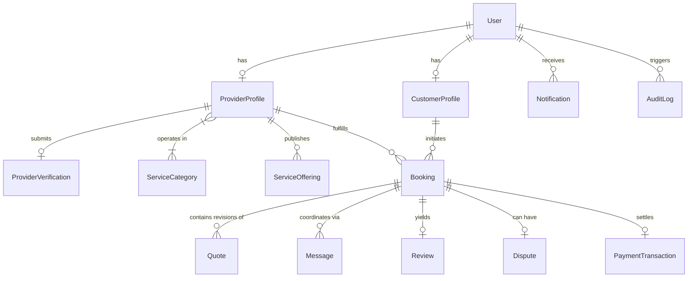

# Lehulu (ለሁሉ) — Database Schema & Data Models Specification

## 1. Schema Design Principles
- **MongoDB Atlas with Mongoose ORM**: Utilizing strict type casting, schema validations, compound indexes, and referential integrity checks.
- **Geospatial Indexing**: 2dsphere indexes on GeoJSON coordinates (`[longitude, latitude]`) enabling low-latency proximity queries across Ethiopian cities (Adama, Bishoftu, Addis Ababa).
- **Auditability & Traceability**: Timestamps on all collections; soft deletion for critical operational logs; dedicated `AuditLog` for administrative interventions.
- **Data Privacy by Design**: Private customer addresses and provider identity verification documents exist in distinct schemas or sub-documents gated by field-level authorization.

---

## 2. Entity Relationship Overview



---

## 3. Core Models & Schema Definitions

### 3.1 User Model (`users`)
Central identity store linked to Google authentication.
```typescript
interface IUser {
  _id: ObjectId;
  googleId: string; // Indexed, unique
  email: string; // Indexed, unique, lowercase, trimmed
  displayName: string;
  username: string; // Indexed, unique
  avatarUrl?: string;
  phoneNumber?: string;
  role: 'CUSTOMER' | 'SERVICE_PROVIDER' | 'ADMIN';
  preferredLanguage: 'en' | 'am';
  city: 'Adama' | 'Bishoftu' | 'Addis Ababa' | 'Other';
  isActive: boolean;
  isOnboarded: boolean;
  lastLoginAt: Date;
  createdAt: Date;
  updatedAt: Date;
}
```
**Indexes**:
- `{ googleId: 1 }` (unique)
- `{ email: 1 }` (unique)
- `{ username: 1 }` (unique)
- `{ role: 1 }`

---

### 3.2 ProviderProfile Model (`provider_profiles`)
Professional trade profile.
```typescript
interface IProviderProfile {
  _id: ObjectId;
  userId: ObjectId; // Ref to User, unique
  businessName: string;
  bioEn: string;
  bioAm?: string;
  experienceYears: number;
  categoryIds: ObjectId[]; // Ref to ServiceCategory
  skills: string[];
  serviceCities: string[]; // ['Adama', 'Bishoftu']
  serviceRadiusKm: number; // default 15km
  location: {
    type: 'Point';
    coordinates: [number, number]; // [lng, lat]
  };
  publicAddress?: string; // Workshop or general district, NOT private home
  pricing: {
    model: 'HOURLY' | 'FIXED' | 'INSPECTION' | 'CUSTOM';
    startingPrice: number; // ETB
    hourlyRate?: number;
    inspectionFee?: number;
  };
  workingHours: {
    dayOfWeek: number; // 0 (Sun) - 6 (Sat)
    open: string; // "08:00"
    close: string; // "18:00"
    isClosed: boolean;
  }[];
  portfolioImages: string[];
  isVerified: boolean; // default false, Admin only
  verificationStatus: 'PENDING_REVIEW' | 'VERIFIED' | 'REJECTED' | 'NEEDS_RECHECK' | 'SUSPENDED';
  rating: number; // default 0.0, derived from completed reviews
  reviewCount: number; // default 0
  completedBookingsCount: number; // default 0
  isAvailable: boolean;
  createdAt: Date;
  updatedAt: Date;
}
```
**Indexes**:
- `{ userId: 1 }` (unique)
- `{ location: '2dsphere' }`
- `{ categoryIds: 1, isVerified: 1, isAvailable: 1 }`
- `{ serviceCities: 1 }`

---

### 3.3 ProviderVerification Model (`provider_verifications`)
Administrative credential verification evidence.
```typescript
interface IProviderVerification {
  _id: ObjectId;
  providerProfileId: ObjectId; // Ref to ProviderProfile, unique
  userId: ObjectId; // Ref to User
  nationalIdNumber: string;
  idCardImageUrl: string;
  tradeLicenseUrl?: string;
  certificateUrls: string[];
  status: 'PENDING_REVIEW' | 'VERIFIED' | 'REJECTED' | 'NEEDS_RECHECK' | 'SUSPENDED';
  reviewedBy?: ObjectId; // Ref to User (Admin)
  rejectionReason?: string;
  adminNotes?: string;
  submittedAt: Date;
  reviewedAt?: Date;
}
```

---

### 3.4 ServiceCategory Model (`service_categories`)
Database-driven service catalog.
```typescript
interface IServiceCategory {
  _id: ObjectId;
  nameEn: string;
  nameAm: string;
  slug: string; // unique (e.g. 'electricians', 'plumbers')
  descriptionEn: string;
  descriptionAm: string;
  icon: string; // Lucide icon identifier
  displayOrder: number;
  isActive: boolean;
  subcategories: {
    nameEn: string;
    nameAm: string;
    slug: string;
  }[];
}
```

---

### 3.5 Booking Model (`bookings`)
Core transactional agreement.
```typescript
interface IBooking {
  _id: ObjectId;
  bookingNumber: string; // Unique human-readable e.g. "LHL-2026-10492"
  customerId: ObjectId; // Ref to User
  providerId: ObjectId; // Ref to ProviderProfile
  categoryId: ObjectId; // Ref to ServiceCategory
  status: 'REQUESTED' | 'AWAITING_QUOTE' | 'QUOTED' | 'CONFIRMED' | 'IN_PROGRESS' | 'COMPLETION_PENDING' | 'COMPLETED' | 'CANCELLED' | 'DISPUTED';
  requestedDate: Date;
  requestedTimeSlot: string; // e.g. "09:00 - 12:00"
  problemDescription: string;
  referenceImages: string[];
  serviceAddress: {
    city: 'Adama' | 'Bishoftu' | 'Addis Ababa' | 'Other';
    subcity?: string;
    kebele?: string;
    streetAddress: string;
    coordinates?: [number, number];
    contactPhone: string;
  };
  agreedPrice?: {
    amount: number;
    currency: 'ETB';
    pricingModel: 'HOURLY' | 'FIXED' | 'INSPECTION' | 'CUSTOM';
    isFinal: boolean;
  };
  cancellationReason?: string;
  cancelledBy?: ObjectId;
  completionRequestedAt?: Date;
  completedAt?: Date;
  createdAt: Date;
  updatedAt: Date;
}
```
**Indexes**:
- `{ bookingNumber: 1 }` (unique)
- `{ customerId: 1, status: 1 }`
- `{ providerId: 1, status: 1 }`
- `{ createdAt: -1 }`

---

### 3.6 Quote Model (`quotes`)
Formal price proposals from providers.
```typescript
interface IQuote {
  _id: ObjectId;
  bookingId: ObjectId; // Ref to Booking
  providerId: ObjectId; // Ref to ProviderProfile
  customerId: ObjectId; // Ref to User
  quoteNumber: string;
  items: {
    description: string;
    quantity: number;
    unitPrice: number;
    total: number;
  }[];
  totalAmount: number;
  currency: 'ETB';
  estimatedDurationHours?: number;
  inspectionIncluded: boolean;
  notes?: string;
  status: 'PROPOSED' | 'ACCEPTED' | 'REJECTED' | 'SUPERSEDED';
  validUntil: Date;
  createdAt: Date;
}
```

---

### 3.7 Review Model (`reviews`)
Verified customer feedback.
```typescript
interface IReview {
  _id: ObjectId;
  bookingId: ObjectId; // Ref to Booking, unique
  customerId: ObjectId; // Ref to User
  providerId: ObjectId; // Ref to ProviderProfile
  rating: number; // 1 to 5 integer
  comment: string;
  providerResponse?: {
    text: string;
    respondedAt: Date;
  };
  isReported: boolean;
  createdAt: Date;
}
```
**Indexes**:
- `{ bookingId: 1 }` (unique: strictly one review per completed booking)
- `{ providerId: 1, rating: -1 }`

---

### 3.8 Message Model (`messages`)
In-app communication between customer and provider for a specific booking.
```typescript
interface IMessage {
  _id: ObjectId;
  bookingId: ObjectId; // Ref to Booking
  senderId: ObjectId; // Ref to User
  recipientId: ObjectId; // Ref to User
  senderRole: 'CUSTOMER' | 'SERVICE_PROVIDER' | 'ADMIN';
  content: string;
  attachments?: string[];
  readAt?: Date;
  createdAt: Date;
}
```

---

### 3.9 Notification Model (`notifications`)
User notification inbox.
```typescript
interface INotification {
  _id: ObjectId;
  userId: ObjectId; // Ref to User
  type: 'BOOKING_REQUEST' | 'QUOTE_RECEIVED' | 'QUOTE_ACCEPTED' | 'BOOKING_CONFIRMED' | 'IN_PROGRESS' | 'COMPLETION_PENDING' | 'BOOKING_COMPLETED' | 'NEW_MESSAGE' | 'VERIFICATION_UPDATE' | 'REVIEW_RECEIVED';
  titleEn: string;
  titleAm: string;
  messageEn: string;
  messageAm: string;
  referenceId?: ObjectId;
  referenceType?: 'Booking' | 'Quote' | 'ProviderVerification';
  isRead: boolean;
  createdAt: Date;
}
```

---

### 3.10 AuditLog Model (`audit_logs`)
Immutable administrative audit record.
```typescript
interface IAuditLog {
  _id: ObjectId;
  actorId: ObjectId; // Ref to User (Admin)
  actorEmail: string;
  action: 'PROVIDER_APPROVED' | 'PROVIDER_REJECTED' | 'PROVIDER_SUSPENDED' | 'CATEGORY_CREATED' | 'CATEGORY_UPDATED' | 'DISPUTE_RESOLVED';
  entityType: string;
  entityId: ObjectId;
  details: Record<string, any>;
  ipAddress?: string;
  userAgent?: string;
  timestamp: Date;
}
```
